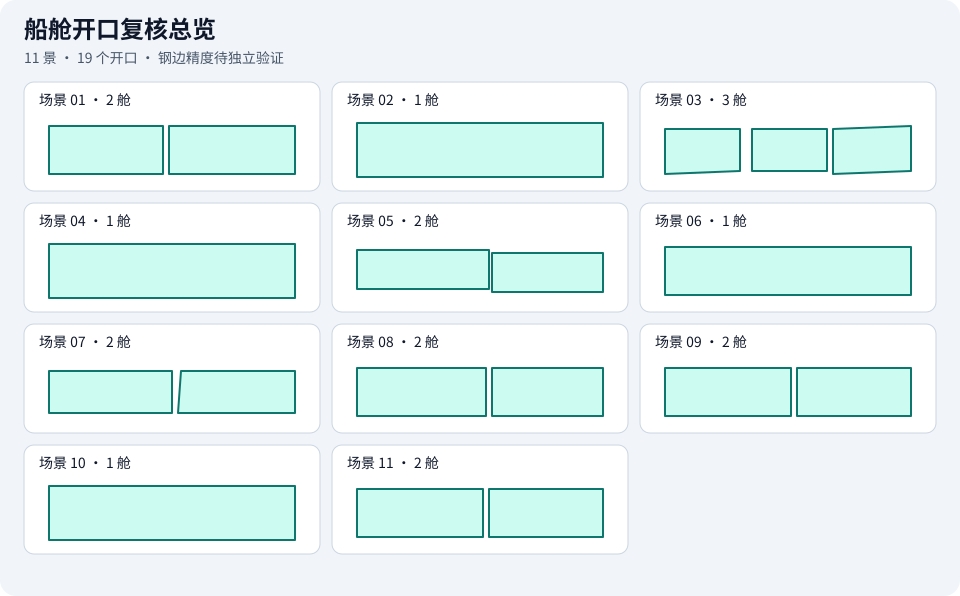

# Ship-Unloader

基于激光雷达 XYZ 点云的船舱开口识别与离线人工复核工具。输入 PCD 或单帧 ROS2 点云，输出开口边界、四角 XYZ、长宽、中文复核图及逐边原始证据。

适用于离线二维识别和人工辅助复核。缺测 Z 保留 `null`，歧义及严格矩形未决分别记录；复核结果不具备设备运动控制资格。

## 安装与运行

需要 Git、Python 和 pip，兼容环境及中文字体配置见[部署与使用](docs/部署与使用.md)。离线 PCD 不需要 ROS2 或 C++ 构建。

```bash
git clone https://github.com/guolichen007/Ship-Unloader.git
cd Ship-Unloader
```

Ubuntu：

```bash
bash scripts/install_review_env.sh
bash scripts/run_review.sh /data/input.pcd ./output --mode full
```

Windows 命令提示符：

```bat
scripts\install_review_env.bat
scripts\run_review.bat "D:\pcd\input.pcd" "D:\pcd\output" --mode full
```

输入也可以是包含 PCD 的目录。已有数值环境可通过 `PYTHON_BIN` 指定解释器。

| 参数 | 用途 |
| --- | --- |
| `--mode full` | 完整识别、精修与输出 |
| `--mode staged` | 预览后利用校验快照继续完整识别 |
| `--mode preview` | 仅生成预览，不能代替完整精修 |
| `--frame-id` | 标记输入坐标系，不转换坐标 |
| `--rounds` | 重复运行并分别记录结果 |

## 输入与算法

支持包含 `x/y/z` 的 ASCII、binary 和 binary_compressed PCD，保留原始坐标及点索引。强度字段不参与识别评分。

处理流程为：船体分组与局部坐标 → 多源开口候选 → 成员及隔板归属 → 独立 Raw 逐边证据 → 联合矩形与复核建议 → 四角 XYZ、尺寸和来源导出。

多船场景需要可信泊位参考或操作员确认的船体范围。目标船不能唯一确定时保留未决证据，不猜选目标、不跨船拼框。场景名、人工舱角、预期舱数和宽度不作为识别依据。

## 识别效果



图中 11 景共 19 个开口。每景只展示本次二维复核框，独立调整方向和比例，省略点云、真实坐标及采集信息。钢边精度待独立验证。

## 输出

每次调用在输出根目录下创建独立运行目录。打开终端打印的 `REVIEW_INDEX` 查看本次复核页。该目录的 `运行总表.csv` 记录耗时、退出状态、失败原因及通过检查的结果路径。每场结果包含：

- 原始点云与复核框叠加图、新旧候选四栏图和中文审图页面。
- 四角 XYZ、长宽、严格矩形状态及二维复核状态的 JSON/CSV。
- 逐边 Raw 索引、支持断面、残差、不确定性及拒绝原因。
- 输入、源码和配置摘要，以及阶段耗时和资源记录。

坐标单位为米，图中两位小数仅为显示格式。程序正常退出、严格矩形可解或复核框数量正确，均不等于真实钢边精度通过。缺测高度不补值，失败与未决结果不会改写为成功。

## 文档与开发

- [文档索引](docs/README.md)
- [部署与使用](docs/部署与使用.md)
- [算法原理](docs/算法原理.md)
- [输出格式](docs/输出格式.md)
- [测试与限制](docs/测试与限制.md)
- [开发与 Git 协作规范](docs/05_开发与Git协作规范.md)

源码位于 `ship_perception/`，一键入口位于 `scripts/`。客户点云、人工审核表、完整 Raw 证据及运行产物保存在本地数据和工作目录，不进入 Git。
